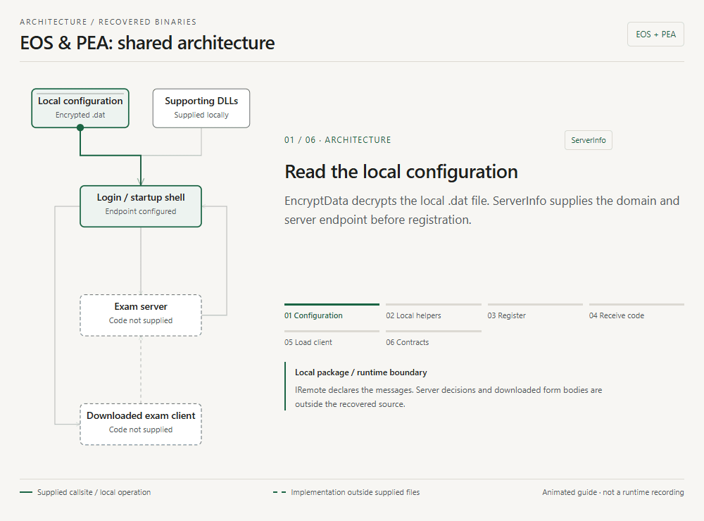
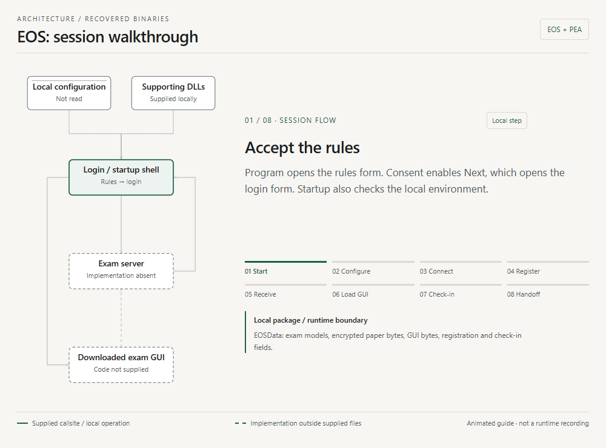
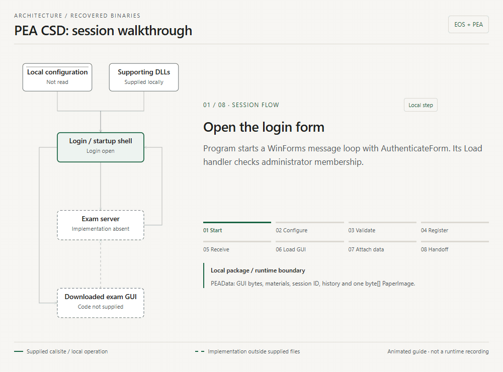

# Exam tools reconstruction

Readable C# reconstructed from the supplied **EOS**, **PEA CSD** and **PEA PRN** Windows exam-client packs. This repository explains their startup, registration, library behavior and handoff to the exam interface. It contains **13 buildable application assemblies, 1,426 indexed method declarations, and bounded checks against the original binaries**.

The key finding: **the EXE is a bootstrap and login shell. The actual exam form arrives from the server as a compressed .NET assembly.** Reconstructing the supplied files recovers the local side of that boundary, not the absent server or downloaded exam application.

- [Architecture](#architecture) · [EOS flow](#eos-flow) · [PEA flow](#pea-flow)
- [Source map](#source-map) · [Library details](#library-details) · [Build](#build)
- [Reproduce the analysis](#reproduce-the-analysis) · [Validation](#validation)
- The looping previews below play directly on GitHub. For step controls, themes and feature notes, download [the interactive walkthrough](docs/flow.html) and open it in a browser; GitHub displays HTML as source.

## Scope

This is an available-artifact reconstruction for study and presentation. No lecturer/server source is expected. Other PEA course packs are outside scope.

**EOS** is the protected Windows Forms shell: 23 declared types and 444 methods in `EOSClient.exe`, plus its local contracts and supporting libraries. Its names, constants and dispatcher-style control flow required normalization. Readable names such as `AuthenticateForm` are analyst aliases.

**PEA CSD** is the separate login build from the `PEA_Client_CSD201,PFP191,CSD203_19062023` pack. Its login EXE has five types and 15 methods. Although its folder says offline, the supplied login still calls a remote server.

**PEA PRN** is the login build from the HSF302/SBA301/MSS301/PRN course pack. Its EXE matches the previously compared Coursera login byte for byte; it is not a separate application architecture. Its contract and GradeLib remain build-specific and are reconstructed separately from CSD.

The originals are IL-only PE32 .NET assemblies with CLR `v2.0.50727` metadata. Their configs request .NET Framework 2.0; EOS also allows Framework 4. The readable projects deliberately target **.NET Framework 4.8**. They are compatibility builds, not the original source repository or operational replacements.

## Architecture

This looping architecture preview uses the same graph and visual style as the interactive walkthrough. It follows configuration, local helpers, registration, GUI loading and the submission boundary. Solid arrows represent recovered local operations and calls into declared interfaces. Dashed arrows describe a contract whose downloaded caller and server implementation are outside the supplied files.

[](docs/flow.html)

`IRemote.dll` defines the interfaces and serializable messages. It has no executable entry point and does not implement the exam engine. The proxy address is `tcp://<IP>:<port>/Server`, using **.NET Remoting** rather than HTTP/REST.

The local `*.dat` configuration provides server coordinates before registration. The server then returns session data **and executable GUI bytes**. `Assembly.Load(byte[])` loads the decompressed assembly into the client process; this is a runtime code handoff, not just opening an exam document.

The supplied modules do not define `ExamClient.PreExamEntry`, `ExamClient.frmEnglishExamClient` or `PEAClient.FrmPEAClient`. Their names appear at the load/reflection boundary. Exam navigation, material display, solution selection and the actual submit caller therefore cannot be reconstructed from these files. The interface signatures remain readable and are documented below.

## EOS flow

[](docs/flow.html#eos)

Read [Program.cs](src/EOS/EOSClient/Program.cs), [RulesForm.cs](src/EOS/EOSClient/RulesForm.cs) and [AuthenticateForm.cs](src/EOS/EOSClient/AuthenticateForm.cs).

1. **Start and accept rules.** `Program.Main` installs UI/AppDomain exception handlers and opens `RulesForm`. Consent enables Next. Startup checks administrator membership and whether the executable path looks like a temporary/archive location. Next opens authentication and hides the rules form.
2. **Read configuration.** `LoadServerConfiguration_M004a` decrypts/deserializes `EOS_Server_Info.dat`, reads the domain and populates endpoint choices. `EndpointItem` stores display text, IP, port and `Public_IP`. A selected nonblank `Public_IP` takes precedence over the other IP; it is not a connection-retry loop.
3. **Connect and compare versions.** `ConnectAndPing_M0047` obtains a Remoting proxy and returns it only after a successful `Ping`. `HasVersionMismatch_M0048` compares a nonblank required version against local identifier `2.0.2.6.0.7.2.9` with case-insensitive string equality. Empty responses and exceptions return false; this is not numeric version ordering.
4. **Register.** `LoginClick_M0046` checks the exam code, username, password, domain and endpoint. It sends `RegisterData` through `ConductExam`: trimmed lowercase login, original password/exam code, uppercase machine name and client version. The domain is local configuration, not a separate registration field.
5. **Handle the status.** Only `NEW` and `RE_ASSIGN` enter the success path. Other statuses display their corresponding messages and restore the controls. The server's authentication and assignment decisions are outside the local implementation.
6. **Load the exam assembly.** The shell hides login, GZip-decompresses `EOSData.GUI`, calls `Assembly.Load`, clears the GUI byte array and attaches the local `ServerInfomation` and `RegData`.
7. **Delegate check-in.** Unless `SkipCameraCheckIn` is set, reflection invokes `ExamClient.PreExamEntry.RunCheckIn(ed)`. A null photo restores login with an error. Skipping check-in uses an empty byte array. The camera implementation belongs to the downloaded code; AForge/DirectShow DLLs are bundled locally.
8. **Hand over the session.** The shell creates `ExamClient.frmEnglishExamClient`, calls `IExamclient.SetExamData(ed)`, and passes a nonempty photo through `SetCheckInPhoto`. It attaches a FormClosed callback that stops `ExamNetworkLock` and `ExamAppLock`, then shows the exam form. The local shell establishes these cleanup calls; its source does not establish where the locks are started.

The exception path resets cursor state, displays errors and requests exit. Sound/font checks are auxiliary login features: the shell plays `ghosts.mp3` through NAudio and checks installed font-family names. Neither feature is the exam engine.

EOS's `IRemoteServer` declares six operations: `ConductExam`, `Submit`, `ResyncLocalCache`, `Ping`, `IsMockExam` and `GetMinRequiredClientVersion`. `Submit(SubmitPaper, ref msg)` returns `SubmitStatus`. A separate `IRemoteMonitorServer.SaveScreenImage` is declared; the supplied shell does not establish a caller or monitoring schedule.

## PEA flow

The two login programs share this flow. Read the [CSD login](src/PEA-CSD/PEALogin/PEALogin/AuthenticateForm.cs) and [PRN login](src/PEA-PRN/PEALogin/PEALogin/AuthenticateForm.cs) side by side.

1. **Start.** `PEALogin.Program.Main` enables visual styles and starts the WinForms message loop with `AuthenticateForm`. Its constructor calls `InitializeComponent`, creating inputs and wiring Login, Cancel and Load events.
2. **Load configuration.** `AuthenticateForm_Load` checks administrator membership, decrypts/deserializes `PEA_Server_Info.dat`, compares `ServerInfo.Version` with its local identifier, and fills the disabled domain field. Missing/invalid configuration requests application exit. The file-existence check uses `Application.StartupPath`, while the decryptor receives a relative filename; `Application.Exit()` itself does not return from the handler.
3. **Validate input.** `btnLogin_Click` rejects blank trimmed test name, username, password and domain. It then sends the original textbox values, preserving their whitespace. The domain is checked but not added to `RegisterData`.
4. **Request a session.** `Activator.GetObject` creates the Remoting proxy; the subsequent `ConductTest` call actually makes the registration/session request. `RegisterData` contains Login, Password, TestName, `PaperNo = -1` and uppercase machine name.
5. **Check status and load GUI.** Only `NEW` and `REASSIGN` proceed. The shell decompresses `pd.GUI` using `pd.OriginSize`, loads the assembly and instantiates `PEAClient.FrmPEAClient`, casting it to both `Form` and `IExamclient`.
6. **Hand over data.** It clears `pd.GUI`, sets `pd.ServerInfomation`, calls `SetExamData(pd)` and `SetAuthenForm(this)`, shows the runtime form and hides login. Exceptions display their message. Cancel requests application exit, without a remote cancellation or submit call.

PEA's `IRemoteServer` declares `ConductTest`, `Submit` and `Log`. Submission uses `SubmitSolution`, `SubmitHistory` and `SubmitStatus`. The login EXE itself contains no submit call. Given materials, paper images, history and solution packaging are represented by local contracts/helpers; the downloaded form controls their exam-time use.

### PEA CSD walkthrough

[](docs/flow.html#pea-csd)

### PEA PRN walkthrough

[](docs/flow.html#pea-prn)

### Keep CSD and PRN separate

Both packs contain their own `IRemote.dll`, `GradeLib.dll` and `EncryptData.dll`. Matching assembly/type names do not make the files interchangeable.

- **Paper images:** CSD's `PEAData.PaperImage` is `byte[]`; PRN's is `List<byte[]>`.
- **Test-case discovery:** CSD includes two parser formats. PRN filters text files, resolves referenced data/output files and supports `tc*` subdirectories.
- **GradeLib size:** CSD has 111 method declarations; PRN has 128. These libraries contain models, parsers and packaging helpers, not an established complete grading engine.
- **Registration enums:** EOS uses `RE_ASSIGN = 1`; PEA uses `REASSIGN = 3`. These are different contracts even when their meaning sounds similar.
- **Submit statuses:** PEA includes `INCORRECT_SESSIONID` in addition to the three statuses found on EOS.

## Source map

The project layout follows the actual application assemblies, so build-local contracts stay isolated.

```text
src/
  EOS/
    EOSClient/          444 methods: startup, rules, login, device utilities
    IRemote/             56 methods: EOS session and remote interfaces
    EncryptData/         10 methods: serialization/crypto utilities
    QuestionLib/        504 methods: models, cache, database/lock helpers
    HashCodeProvider/     2 methods: bundled identity-hash utility
  PEA-CSD/
    PEALogin/            15 methods: practical-client bootstrap/login
    IRemote/             62 methods: CSD contracts
    EncryptData/          9 methods: CSD crypto utilities
    GradeLib/           111 methods: CSD models, parsing and packaging
  PEA-PRN/
    PEALogin/            15 methods: practical-client bootstrap/login
    IRemote/             62 methods: PRN contracts
    EncryptData/          8 methods: PRN crypto utilities
    GradeLib/           128 methods: PRN models, parsing and packaging
analysis/                   Compact identities, EOS aliases and validation
scripts/                    Import, build, reconstruction and audit commands
tooling/                   Static analysis, CIL simulation and DLL probes
docs/flow.html             Standalone interactive architecture walkthrough
docs/media/                Four optimized, looping README previews
```

Method counts include constructors, generated accessors, interface declarations and short forwarding wrappers. They do not represent 1,426 separate business features.

For EOS aliases, `_M0046` retains the original MethodDef RID of token `0x06000046`. Use the pack and assembly identity as well as the token: tokens are only meaningful within that particular module. [Assembly identities](analysis/assemblies.json) retain original SHA-256/MVID, and [EOS aliases](analysis/eos-aliases.json) describe the assigned names. Substantive recovered methods also have inline behavior comments.

## Library details

### Serialization, encryption and compression

Each pack's `EncryptData` contains object serialization and cryptographic helpers. Object conversion uses `BinaryFormatter`; file helpers use DES with ASCII-derived key/IV bytes. EOS also includes Rijndael ECB/PKCS7 string helpers. These are recovered legacy behaviors, not recommended designs for a new application.

Preserved quirks matter when reading the code: `GetMD5` decodes raw digest bytes as UTF-16 text rather than returning hexadecimal. The DES string decryptor ignores the read count and decodes its ciphertext-sized output buffer, retaining zero tails. GZip decompression likewise allocates `originSize`, performs one read and returns the allocation without checking that it was filled. Successful bounded fixtures do not remove those general limitations.

### Practical materials and solutions

`GradeLib.SolutionZip.CreateZip` checks that the solution directory exists, totals recursive file sizes and rejects zero bytes or more than 10 MiB. Otherwise it creates a ZIP with Ionic.Zip and returns the ZIP's bytes. `GivenExtract.Extract` extracts with overwrite enabled; failures populate its ref log message and return false.

`TestCase.Validate` only requires `Input.Count > 0 && Mark > 0`. Parser methods read input/output sections, comparison flags and marks. CSD's directory-oriented format recognizes special data/output filenames; PRN can discover `tc*` directories and resolve referenced files. A stored expected output or mark is not evidence of the complete server-side scoring process.

### EOS persistence and models

`QuestionHelper.SaveSubmitPaper` validates the model, locks by normalized login, serializes to `.tmp`, and moves or replaces the main `.dat`, retaining `.bak`. `LoadSubmitPaper` tries the backup after an exception while reading the main file. A missing main file returns null without trying the backup. Write-block exceptions are swallowed.

`Re_ConstructPaper` and its helpers restore question/passage/essay/image/audio presentation fields from an original paper by matching IDs. Their presence in the DLL does not establish invocation by this login shell. The library also contains text normalization, wrapping, time formatting, SQL/NHibernate support and model accessors.

Some oddities belong to the shipped program: `BOBase.ListID` returns null without executing the constructed query in one overload, and several database SaveList paths do not explicitly close their session. Reconstruction preserves those bodies instead of inventing missing work.

### Machine controls and devices

QuestionLib's application-lock helper uses a periodic process sweep and can terminate other processes with main windows under its exclusion rules. Its network-lock helper reads native TCP tables; its IPv4 path can request connection deletion, and its IPv6 path can terminate an owning process after its checks. These bodies and P/Invoke boundaries were reviewed statically. Their timers, network changes and process-control functions were not executed during validation.

The Windows requirement comes from Windows Forms, .NET Framework and native device/OS calls. EOS bundles AForge/DirectShow and uses NAudio for playback. Obfuscation does not create that platform dependency. These binaries do not become cross-platform by renaming or decompiling them.

### Obfuscation and reconstruction changes

EOS defines `ConfusedByAttribute`. Inspection establishes renaming, recognized switch dispatchers, protected constants, packed resources and injected anti-debug logic. The attribute alone would not prove every Confuser protection, and a separate anti-tamper implementation is not established.

The analysis tool assigns traceable names and specializes only the dispatcher pattern it recognizes. A static decoder recovers the constant pool and the rules resource without loading the EXE. The readable build embeds that resource and uses decoded literals; Confuser's injected module source remains in `-Module-.cs` as an **excluded reference file**. Protector startup is therefore an explicit difference from the original.

Other compatibility fixes restore Dispose overrides, a generated resource setter's `value`, access to three nested forwarding helpers, and identity hashing. The original hash utility used a nonvirtual `Object.GetHashCode` call that ILSpy rendered as `obj.GetHashCode()`. The reconstruction uses `RuntimeHelpers.GetHashCode(obj)` to preserve identity behavior, including bypassing an override and returning zero for null. Synthetic comparison caught and verified this correction.

## Build

Use **Windows**, PowerShell 7 and the **.NET 10 SDK**. Framework projects use pinned `Microsoft.NETFramework.ReferenceAssemblies.net48` version `1.0.3`, restored through NuGet. Running the bounded Framework DLL probes also requires the .NET Framework 4.8 runtime. Building is separate from launching an exam client.

The original binary packs are **not committed**. [exam-input-manifest.json](exam-input-manifest.json) records the 42 expected relative paths, sizes and SHA-256 values. Import your supplied copies; each argument points directly at the folder containing the relevant EXE and sibling DLLs:

```powershell
./scripts/Import-Inputs.ps1 `
  -EOSPath 'D:\supplied\EOS' `
  -CSDPath 'D:\supplied\PEA-CSD' `
  -PRNPath 'D:\supplied\PEA-PRN'

./scripts/Build-Reconstruction.ps1
```

The importer validates all source hashes before copying into ignored `inputs/EOS`, `inputs/PEA-CSD` and `inputs/PEA-PRN`. Projects use repository-relative dependency paths, without the analyst's machine paths. Direct external references are NAudio and NHibernate for EOS, and Ionic.Zip for each PEA build. First-party references point to the reconstructed projects.

The build script compiles all 13 projects through four roots and records exit codes/logs under ignored `evidence/`. EOS's output is `src/EOS/EOSClient/bin/Debug/net48/EOSClient.Reconstructed.exe`; each PEA output is `src/<pack>/PEALogin/bin/Debug/net48/PEALogin.exe`. Successful compilation does not supply a server, download the absent forms or validate a production exam session.

## Reproduce the analysis

For full regeneration, also install **Python 3.10+** and **Node.js/npm**. The script uses REA `6.8.0` through `npx`, installs ILSpy `11.2.0.10050` into ignored `.tools/`, and restores dnlib `4.5.0` plus the matching decompiler package for the local analysis tool. Package installation requires network access; no exam server is contacted.

```powershell
# Import the exact input packs first, then regenerate and run all bounded checks.
./scripts/Reconstruct.ps1

# Re-run checks against the current source after evidence has been generated.
./scripts/Audit-Reconstruction.ps1

# Optional: force a fresh initial REA / ILSpy capture.
./scripts/Reconstruct.ps1 -RefreshEvidence

# Rebuild only the standalone architecture walkthrough.
python ./scripts/make_overview.py
```

The reconstruction stages are: verify inputs → capture metadata/original IL → normalize EOS names/dispatchers → decompile → decode constants/resources offline → prepare compatibility projects → index methods → annotate behavior → build and compare. `Reconstruct.ps1` rewrites generated files under `src/`; preserve any manual experiments before regenerating.

`tooling/Reconstruction.Tool` parses assemblies and interprets selected login CIL against mocks. `tooling/LibraryProbe` executes only a fixed allowlist of DLL helpers, in separate original/rebuilt processes with synthetic fixtures. It never loads a client EXE. The scripts fail on missing observations, unsupported modeled calls or comparison failures.

To regenerate the four README GIFs from the HTML export view:

```powershell
npm ci
npm run docs:gifs
```

The renderer uses installed Chrome/Edge or Playwright Chromium. Set `CHROME_PATH` to override discovery; if no browser is available, run `npx playwright-core install chromium`. It captures deterministic steps from the HTML with 25 fps marker motion, short holds and a shared 128-color palette per GIF. Each step takes about 1.6 seconds; the detailed text and interactive HTML remain available for slower exploration. The animations are illustrative guides, not runtime recordings. PNG capture frames, palettes and the render receipt stay under ignored `evidence/readme-animation/`; only the four optimized GIFs are committed.

Raw REA captures, initial decompiles, method exports, normalized binaries, fixtures, screenshots, build logs and the full method catalog are generated locally and ignored. They remain reproducible without committing duplicate source trees or multi-megabyte generated documentation. A compact audit summary, source digests and assembly identities are retained under `analysis/`.

## Validation

The recorded bounded audit establishes:

- **42/42** original input hashes matched; **13/13** reconstructed projects compiled.
- **29** contract types matched field names/types/constants, method signatures and Serializable status.
- **444** normalized EOS methods retained ordered original call tokens and exception-clause counts. This supports provenance, not control-flow equivalence.
- **1,046/1,426** method declarations matched canonical IL. The count includes declarations; mismatches do not automatically mean an error.
- **105** original/rebuilt synthetic DLL-helper observations matched: 45 EOS, 29 CSD and 31 PRN. Checks also assert meaningful successful outcomes such as large GZip round trips, valid extraction and backup recovery.
- **54** mocked login scenarios matched observable event order and modeled final state: registration statuses, blank fields, proxy/GUI failures and EOS-specific version, endpoint and check-in branches.

See [analysis/validation.json](analysis/validation.json) for the source SHA-256 digests, counts and limitations. Running the audit regenerates this summary for the current source. Compiler warnings from generated fields/native marshaling structures remain visible in local build logs.

**No exam client was launched, no genuine exam payload was decrypted, and no exam server was contacted.** Selected DLL helpers were executed with synthetic data; login behavior was modeled through CIL interpretation. Camera/monitoring, database operations, lock timers and process/network-control helpers were not executed. These checks do not prove full behavioral equivalence, production wire compatibility or that a real exam session will work.

Original author/copyright metadata remains in the recovered source. This repository records reconstructed code and analysis; it does not claim that the recovered identifiers or implementations are newly authored original application source.
